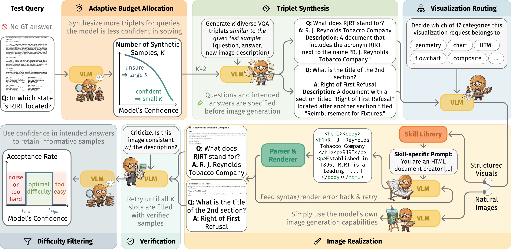

<p align="center">
<h1 align="center"><strong>SIMIT: Self-Improving Vision-Language Models via Imagination at Test-Time</strong></h1>
  <p align="center">
    <em><a href="https://monurcan.github.io/">Mehmet Onurcan Kaya</a><sup>1,2</sup>, <a href="https://elliottd.github.io/">Desmond Elliott</a><sup>3,2</sup>, <a href="https://dimipapa.github.io/">Dim P. Papadopoulos</a><sup>1,2</sup></em>
  </p>
  <p align="center">
    <em><sup>1</sup> Technical University of Denmark &nbsp;&nbsp;&nbsp; <sup>2</sup> Pioneer Center for AI &nbsp;&nbsp;&nbsp; <sup>3</sup> University of Copenhagen</em>
  </p>
</p>

<div id="top" align="center">

[](https://monurcan.github.io/simit)
[](https://monurcan.github.io/simit/static/pdf/paper.pdf)
[](https://huggingface.co/spaces/monurcan/simit)
[](https://pypi.org/project/simit/)

</div>

> [!IMPORTANT]
> **Want to use SIMIT in your own project? Use the pip library:**
> ```bash
> pip install simit
> ```
> [`simit`](https://pypi.org/project/simit/) ([GitHub](https://github.com/monurcan/simit)) is the lightweight,
> user-friendly implementation of SIMIT-ICL. It works with BAGEL, Lance and any Hugging Face VLM in a few lines of code:
> ```python
> from simit import SIMIT
> model = SIMIT.from_pretrained("ByteDance-Seed/BAGEL-7B-MoT")
> demos = model.imagine(image, question)          # self-generated (image, question, answer) demos
> answer = model.answer(image, question, demos)
> ```
> **This repository is the research codebase.** It contains everything needed to reproduce the
> experiments of the paper: synthetic data generation, SIMIT-ICL / SIMIT-FT, all baselines, ablations,
> analyses and figures. It is not meant as a library.

<div align="center">
    
</div>

Given an unlabeled test query, the model allocates a synthesis budget from its own confidence
(adaptive budget allocation), proposes diverse question–answer pairs with corresponding image
descriptions (triplet synthesis), and realizes the images either with its native image generation or
with a library of rendering skills for structured visuals (documents, charts, diagrams, molecules, ...).
Answers are fixed before images are realized; verification and difficulty filtering retain accurate and
informative examples. The same model serves as synthesizer, router, critic and solver, and then
self-improves with the final samples via in-context learning (SIMIT-ICL) or finetuning (SIMIT-FT).

## 🔎 Abstract
We introduce SIMIT, a test-time self-improvement framework in which a vision-language model creates its
own query-specific training data before answering an unlabeled test query. Our goal is to improve
performance on a given target test set without annotations or external models. To pursue this goal, some
test-time methods improve answers through longer reasoning or repeated sampling but leave the model
unchanged. Others update the model using rewards based on majority agreement among multiple candidate
answers or the model's own judgments of correctness, but such rewards can reinforce existing mistakes.
SIMIT instead imagines similar problems whose solutions it controls: a model need not correctly solve the
target query to construct useful practice examples. It synthesizes diverse (question, answer, image)
triplets by specifying each answer before realizing its image. To support diverse multimodal tasks, SIMIT
combines native image generation with an extensible skill library for structured visuals, including
documents, charts, and diagrams. Within this pipeline, multi-stage verification checks that images support
their assigned answers, while difficulty filtering retains informative examples. Adaptive budgeting further
targets this practice by allocating more samples to queries the model is less confident in answering. The
resulting data can improve the model in-context (SIMIT-ICL) or in-weight (SIMIT-FT). Across 17 diverse
benchmarks, SIMIT outperforms existing self-improvement methods. Its best configuration achieves a +7.20%
mean relative gain over BAGEL-7B, while training-free SIMIT-ICL achieves +6.98%.

## 🔧 Installation
The code was run on Linux with NVIDIA H100 (80GB) GPUs and CUDA 12 (Java is needed for the
captioning metrics). It uses two Python environments,
created with [uv](https://docs.astral.sh/uv/): one for the [M\*](README_MSTAR.md) inference server that
serves BAGEL during data synthesis, and one for BAGEL finetuning and lmms-eval evaluation.

```bash
git clone https://github.com/monurcan/simit_paper.git
cd simit_paper
source simit_env.sh   # sets SIMIT_ROOT and SIMIT_DATA (large outputs, default: ./workdir); source it in every shell

# 1) M* server + synthesis pipeline (Python 3.12) -> .venv
uv venv .venv --python 3.12 --seed
uv pip install --python .venv -r requirements/mstar.txt --no-deps \
    --index-strategy unsafe-best-match --extra-index-url https://download.pytorch.org/whl/cu128
uv pip install --python .venv -e . --no-deps

# 2) BAGEL finetuning + evaluation (Python 3.10) -> Bagel/.venv
uv venv Bagel/.venv --python 3.10 --seed
uv pip install --python Bagel/.venv -r requirements/bagel.txt --no-deps
uv pip install --python Bagel/.venv flash-attn==2.5.8 --no-build-isolation --no-deps   # compiles; needs nvcc
uv pip install --python Bagel/.venv -e lmms-eval --no-deps
# pycocoevalcap's METEOR scorer never reads its stderr pipe and can deadlock on long caption evals
sed -i 's/stderr=subprocess.PIPE/stderr=subprocess.DEVNULL/' Bagel/.venv/lib/python3.10/site-packages/pycocoevalcap/meteor/meteor.py

# 3) BAGEL-7B-MoT weights
.venv/bin/hf download ByteDance-Seed/BAGEL-7B-MoT --local-dir Bagel/models/BAGEL-7B-MoT
```

The rendering skills also need a headless Chromium (HTML skills; `chromium-browser` on `PATH`, or set
`SIMIT_CHROMIUM=/path/to/chrome`) and the Mermaid CLI in a local Node environment:
```bash
.venv/bin/pip install nodeenv && .venv/bin/nodeenv --node=20.20.2 .nodeenv
PATH=$PWD/.nodeenv/bin:$PATH npm install -g @mermaid-js/mermaid-cli
```

The requirement files are the exact package lists of the environments used for the paper (hence
`--no-deps`). Optional environments, installed the same way (see the first lines of each file):
`rag_retrieval/.venv` (Python 3.10, `requirements/rag_retrieval.txt`) for the real-data references
(RICES, TTT-NN, SFT), and `Other_UMMs/.venv` (Python 3.12, `requirements/other_umms.txt` +
`Other_UMMs/environment/install_patches.sh`) for SenseNova-U1 and Lance.

## 📦 Data
No datasets are shipped; everything is downloaded from the Hugging Face Hub and split by scripts:

| Split | Size / benchmark | Used for | Source |
|---|---|---|---|
| Eval | 500 | reported results only | [`lmms-lab/LMMs-Eval-Lite`](https://huggingface.co/datasets/lmms-lab/LMMs-Eval-Lite), downloaded by lmms-eval (`<task>` tasks, e.g. `ai2d_lite`) |
| Validation | 50 | all hyperparameter tuning (SIMIT and baselines) | carved from the full benchmark, disjoint from the eval split (`<task>_val50` tasks) |
| Retrieval / training | 2000 | real-data references only (RICES, TTT-NN, SFT) | the rest of the full benchmark, capped to 2000 by `rag_retrieval/build_capped_index.py` |

```bash
Bagel/.venv/bin/python rag_retrieval/build_retrieval_sets.py --all     # validation + retrieval pools (dedup vs. Lite)
Bagel/.venv/bin/python rag_retrieval/build_val50_datasets.py --all     # -> $SIMIT_DATA/val50/<task> (Lite schema)
.venv/bin/python similar_samples_llms_eval_lite/fetch_gqa_images.py     # GQA Lite images for synthesis
```
`build_retrieval_sets.py` downloads the full source benchmarks (several hundred GB in the HF cache); use
`--benchmark ai2d_lite` to build one benchmark at a time.

**Tuning protocol.** Every hyperparameter of SIMIT (ABA, DF, number of demos, LoRA settings) and of every
baseline is selected on the 50-sample validation split. The 500-sample eval split is evaluated once per
benchmark with the selected configuration. Each sweep therefore has two stages: the search (scored on
`<task>_val50`), then `--finalize`, which evaluates the best validation trial on `<task>` and writes it to
`$SIMIT_DATA/hparams/<sweep>/<bench>.json`.

## 💻 Quick Start: SIMIT-ICL on a few validation queries
```bash
source simit_env.sh
# 1. imagine K=4 practice samples per query (starts its own M* BAGEL server on the visible GPU)
similar_samples_llms_eval_lite/run_synthesis.sh nodf4 val50 ai2d       # pool / split / benchmark(s)
# 2. confidence of every query and synthetic sample (for adaptive budgeting and difficulty filtering)
Bagel/.venv/bin/python similar_samples_llms_eval_lite/compute_confidence.py --mode full \
    --datasets $SIMIT_DATA/generated_samples_discard_unverified_no_diff_filtering_4_samples --benchmarks ai2d_val50
# 3. zero-shot vs. SIMIT-ICL (4 demos, DF+ABA off) on the validation split
MODEL=$SIMIT_ROOT/Bagel/models/BAGEL-7B-MoT
Bagel/run_bagel_eval.sh $MODEL ai2d_lite_val50 $SIMIT_DATA/quickstart/zero_shot
Bagel/run_bagel_icl_eval.sh $MODEL ai2d_lite_val50 $SIMIT_DATA/quickstart/simit_icl 4 0 0 0 0 0 0 0 1 nodf4
```
For a smoke test, append `--limit=3` to the synthesis command and `--limit 3` to the evaluations (for
`run_bagel_icl_eval.sh`, pass `"" ""` before extra lmms-eval arguments). `run_synthesis.sh` starts an M*
server on port 8000 (first start compiles kernels for a few minutes), reuses it if one is already running,
and leaves it running afterwards; stop it with `kill` when you are done.

## 🧪 Reproducing the Paper
[`REPRODUCE.md`](REPRODUCE.md) lists the command for every table and figure. The main pipeline:

1. **Synthesize** practice samples for the eval and validation queries: `run_synthesis.sh {v2,nodf4} {lite,val50}` (Kmax = 6 / 4).
2. **Score** them with `compute_confidence.py`.
3. **Tune on validation, then evaluate once:** `Bagel/run_icl_sweep.py` (SIMIT-ICL), `Bagel/run_tta_sweep.py` (SIMIT-FT, Single-Query), `Bagel/run_ft_sweep.py` (SIMIT-FT, Test-Set), each followed by `--finalize`; `Bagel/run_ft_icl.py` (SIMIT-FT→ICL).
4. **Baselines:** `Bagel/run_baselines.sh` (zero-shot, thinking, self-consistency, self-refine) and `LFRL_Baselines/sweep_lfrl.py` (TTRL, EMPO, TTRV, SRLM).

Sweeps submit their trials as LSF (`bsub`) jobs; set `SIMIT_LSF_SLOTS` (queues) or `SIMIT_LAUNCHER=local`
to run trials one by one on the current machine. Runtimes in the paper are for a single H100.

## 🚀 Repository Structure
| Folder | Contents |
|---|---|
| [`similar_samples_llms_eval_lite/`](similar_samples_llms_eval_lite) | triplet synthesis + image realization + verification (`synthesize_vqa.py`), confidence scoring (`compute_confidence.py`) |
| [`examples/diagram_gen/`](examples/diagram_gen) | visualization routing and the skill library: prompts, parsers and deterministic renderers for the 17 categories |
| [`Bagel/`](Bagel) | BAGEL (training code with LoRA) and all SIMIT / baseline experiment launchers and sweeps |
| [`lmms-eval/`](lmms-eval) | evaluation; SIMIT models in `lmms_eval/models/simple/bagel_{icl,tta,batch}.py`, `*_val50` validation tasks |
| [`LFRL_Baselines/`](LFRL_Baselines) | TTRL, EMPO, TTRV, SRLM reimplementations for BAGEL |
| [`rag_retrieval/`](rag_retrieval) | data splitting (validation / retrieval pools) and Qwen3-VL-Embedding retrieval for RICES / TTT-NN |
| [`Other_UMMs/`](Other_UMMs) | SIMIT-ICL with SenseNova-U1 and Lance (App. K) |
| [`analyses/`](analyses), [`visualization_scripts/`](visualization_scripts), [`speed_experiments/`](speed_experiments), [`eval_ci_tools/`](eval_ci_tools) | supervision-quality audits, stratified gains, figures, runtime measurements, bootstrap CIs |
| [`gradio/`](gradio) | source of the [Hugging Face demo](https://huggingface.co/spaces/monurcan/simit) (built on the `simit` pip package) |
| [`mstar/`](mstar), `configs/`, `benchmark/`, `test/`, `docs/` | the [M\*](README_MSTAR.md) serving system |

## 🙏 Acknowledgement
This project builds upon [M\*](https://github.com/mstar-project/mstar) (fast BAGEL inference, see
[`README_MSTAR.md`](README_MSTAR.md)), [BAGEL](https://github.com/ByteDance-Seed/Bagel),
[lmms-eval](https://github.com/EvolvingLMMs-Lab/lmms-eval) and
[vLLM-Omni](https://github.com/vllm-project/vllm-omni).

## 📚 Citation
```
@article{kaya2026simit,
  title   = {{SIMIT}: Self-Improving Vision-Language Models via Imagination at Test-Time},
  author  = {Kaya, Mehmet Onurcan and Elliott, Desmond and Papadopoulos, Dim P.},
  journal = {arXiv preprint arXiv:XXXX.XXXXX},
  year    = {2026}
}
```

## 💬 Contact
For questions, please open an issue or contact me at monka@dtu.dk
